<div align="center">

<a href="https://rehmansoft.net">
  
</a>

<a href="https://github.com/anasasif522">
  
</a>

<br>

<a href="#about"><b>About</b></a> &nbsp;·&nbsp;
<a href="#projects"><b>Projects</b></a> &nbsp;·&nbsp;
<a href="#stack"><b>Stack</b></a> &nbsp;·&nbsp;
<a href="#stats"><b>Stats</b></a> &nbsp;·&nbsp;
<a href="#connect"><b>Connect</b></a>


</div>

<a name="about"></a>
<h2 align="center">01 &nbsp;/&nbsp; About</h2>

<table align="center">
<tr>
<td width="52%" valign="top">

I'm a WordPress developer from Lahore, Pakistan, currently studying BS Computer Science at Superior University (2024–2028).

Through **Rehmansoft** — a web design studio with the tagline *"Linking the world"* — I build websites and online stores, backed by 3 years of experience in web design.

My work spans WordPress, Shopify, e-commerce, Python automation, AI chatbots and digital marketing. I care about sites that look sharp, load fast and actually help a business grow.

</td>
<td width="48%" valign="top">

```js
const anas = {
  name: "Mian Anas Asif",
  location: "Lahore, Pakistan",
  focus: "WordPress Development",
  studio: "Rehmansoft",
  studying: "BS Computer Science",
  university: "Superior University",
  experience: "3 years in web design",
  toolbox: ["WordPress", "Shopify", "Python"],
};
```

</td>
</tr>
</table>

<div align="center"></div>

<a name="projects"></a>
<h2 align="center">02 &nbsp;/&nbsp; Featured Projects</h2>

<table align="center">
<tr>
<td colspan="2" valign="top">

<h3><a href="https://rehmansoft.net/rehmansoft-our-portfolio/">Portfolio &nbsp;↗</a></h3>
<p>A curated showcase of the websites and digital projects I've built under Rehmansoft — the quickest way to see my WordPress and e-commerce work in one place.</p>
<sub><code>Portfolio</code> &nbsp;·&nbsp; <a href="https://rehmansoft.net/rehmansoft-our-portfolio/">Open portfolio →</a></sub>

</td>
</tr>
<tr>
<td width="50%" valign="top">

<h3><a href="https://eveline.pk/">Eveline.pk &nbsp;↗</a></h3>
<p>A live website from my portfolio. <i>[ADD: one line on what Eveline.pk sells or offers, and your role]</i></p>
<sub><code>Live website</code> &nbsp;·&nbsp; <a href="https://eveline.pk/">Visit site →</a></sub>

</td>
<td width="50%" valign="top">

<h3><a href="https://rehmansoft.net">RehmanSoft &nbsp;↗</a></h3>
<p>My web design studio — <i>"Linking the world."</i> Home of my WordPress, Shopify and web development services.</p>
<sub><code>Studio website</code> &nbsp;·&nbsp; <a href="https://rehmansoft.net">Visit site →</a></sub>

</td>
</tr>
<tr>
<td width="50%" valign="top">

<h3><a href="https://github.com/anasasif522?tab=repositories">Fitness Stop &nbsp;↗</a></h3>
<p>A fitness-focused project. <i>[ADD: what it does and the tech used]</i></p>
<sub><code>Project</code> &nbsp;·&nbsp; <a href="https://github.com/anasasif522?tab=repositories">[ADD REPO / LIVE LINK] →</a></sub>

</td>
<td width="50%" valign="top">

<h3><a href="https://github.com/anasasif522?tab=repositories">Hospital Management System &nbsp;↗</a></h3>
<p>A system for managing hospital operations. <i>[ADD: key features and the tech used]</i></p>
<sub><code>Project</code> &nbsp;·&nbsp; <a href="https://github.com/anasasif522?tab=repositories">[ADD REPO LINK] →</a></sub>

</td>
</tr>
</table>

<div align="center"></div>

<a name="stack"></a>
<h2 align="center">03 &nbsp;/&nbsp; Toolbox</h2>

<div align="center">

<table>
<tr>
<td align="center" width="140"><br><sub><b>WordPress</b></sub></td>
<td align="center" width="140"><br><sub><b>Shopify</b></sub></td>
<td align="center" width="140"><br><sub><b>Python</b></sub></td>
<td align="center" width="140"><br><sub><b>GitHub</b></sub></td>
</tr>
</table>

<sub>E-commerce &nbsp;·&nbsp; Python Automation &nbsp;·&nbsp; AI Chatbots &nbsp;·&nbsp; Web Design &nbsp;·&nbsp; Digital Marketing</sub>

<!-- Add more icons here only for tools you actually use: https://simpleicons.org -->

<br><br>


</div>

<a name="stats"></a>
<h2 align="center">04 &nbsp;/&nbsp; GitHub Stats</h2>

<p align="center">
  
  
</p>

<p align="center">
  
</p>

<p align="center">
  
</p>

<div align="center"></div>

<a name="connect"></a>
<h2 align="center">05 &nbsp;/&nbsp; Connect</h2>

<p align="center">
  <a href="https://github.com/anasasif522"><b>GitHub</b></a> &nbsp;·&nbsp;
  <a href="https://rehmansoft.net"><b>Rehmansoft</b></a> &nbsp;·&nbsp;
  <a href="https://rehmansoft.net/rehmansoft-our-portfolio/"><b>Portfolio</b></a> &nbsp;·&nbsp;
  <a href="https://www.linkedin.com/in/YOUR-LINKEDIN-USERNAME"><b>LinkedIn</b></a> &nbsp;·&nbsp;
  <a href="mailto:YOUR-EMAIL@example.com"><b>Email</b></a>
</p>

<p align="center">
  <sub>Replace the LinkedIn and Email placeholders above, or delete them.</sub>
</p>

<div align="center">


<sub>Designed and built by <b>Mian Anas Asif</b> &nbsp;·&nbsp; Lahore, Pakistan &nbsp;·&nbsp; 2026</sub><br>
<sub><i>Rehmansoft — Linking the world</i></sub>

</div>
